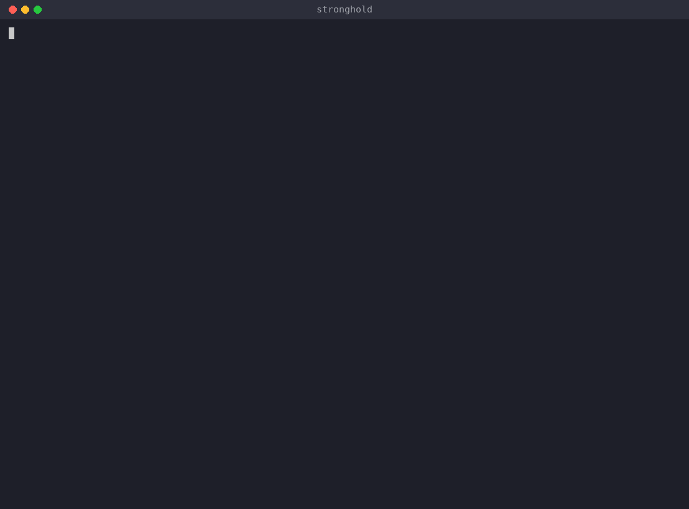

[](https://pepy.tech/projects/stronghold)
[](https://github.com/zlichtman/stronghold/actions/workflows/lockdown.yml)


`stronghold` is the easiest way to securely configure your Mac.



Works on macOS 14 (Sonoma) and later. Every change is tested by applying both modes on macOS 15, 26 and 27. GitHub is retiring its macOS 14 test machines.

**Usage**
---

```
Usage: stronghold.py [OPTIONS]

  Securely configure your Mac.
  Developed by Aaron Lichtman -> (Github: alichtman)


Options:
  -lockdown  Set secure configuration without user interaction.
  -v         Display version and author information and exit.
  -help, -h  Show this message and exit.
```

**Installation Options**
---

1. Install with [`pip`](https://pypi.org/project/stronghold/)
    + `$ pip install stronghold`
    + `$ stronghold`

2. Download the `stronghold` binary from Releases tab.


**Configuration Options**
---

1. Firewall

    + Turn on Firewall?
        - This helps protect your Mac from being attacked over the internet.
    + Turn on logging?
        - If there IS an infection, logs are useful for determining the source.
    + Turn on stealth mode?
        - Your Mac will not respond to ICMP ping requests or connection attempts from closed TCP and UDP networks.

2. General System Protection

    + Enable Gatekeeper?
    	- Defend against malware by enforcing code signing and verifying downloaded applications before allowing them to run.
    + Prevent automatic software whitelisting?
        - Both built-in and downloaded software will require user approval for whitelisting.
    + Disable Captive Portal Assistant and force login through browser on untrusted networks?
        - Captive Portal Assistant could be triggered and direct you to a malicious site WITHOUT any user interaction.
    + Turn on automatic software updates?
        - macOS, security and App Store updates install on their own. Your Mac may restart to finish.

3. User Metadata Storage

    + Clear language modeling metadata?
        - This includes user spelling, typing and suggestion data.
    + Disable language modeling data collection?
    + Clear QuickLook metadata?
    + Clear Downloads metadata?
    + Disable metadata collection from Downloads?
    + Clear SiriAnalytics database?

4. User Safety

    + Lock Mac as soon as screen saver starts?
    + Display all file extensions?
    	- This prevents malware from disguising itself as another file type.
    + Disable saving documents to the cloud by default?
        - This prevents sensitive documents from being unintentionally stored on the cloud.
    + Show hidden files in Finder?
    	- This lets you see all files on the system without having to use the terminal.
    + Disable printer sharing?
        - Offers redundancy in case the Firewall was not configured.

**How to Contribute**
---

1. Clone repo and create a new branch: `$ git checkout https://github.com/alichtman/stronghold -b name_for_new_branch`.
2. Make changes and test
3. Submit Pull Request with comprehensive description of changes

**Acknowledgements**
---

+ [@shobrook](https://www.github.com/shobrook) for logo and UI design assistance.
+ Base logo vector made by [Freepik](https://www.freepik.com/) from [Flaticon](www.flaticon.com).
+ [drduh's macOS-Security-and-Privacy-Guide](https://github.com/drduh/macOS-Security-and-Privacy-Guide) and [Jonathan Levin's MacOS Security Guide](http://newosxbook.com/files/moxii3/AppendixA.pdf) were incredibly helpful while I was building `stronghold`.

**Donations**
---

This is free, open-source software. If you'd like to support the development of future projects, or say thanks for this one, you can donate BTC at `1FnJ8hRRNUtUavngswUD21dsFNezYLX5y9`.
